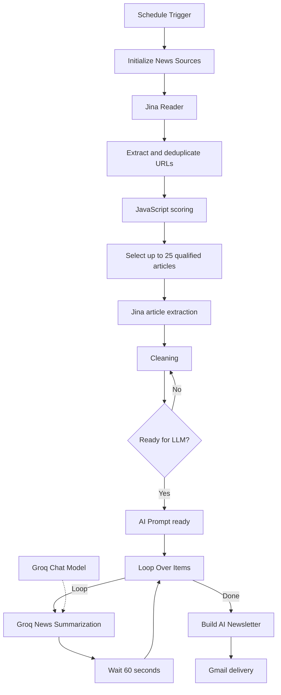

# AI-Powered News Research & Ranking Agent

An end-to-end n8n automation that discovers AI and technology news, ranks articles using deterministic JavaScript scoring, summarizes selected stories through Groq Cloud, and delivers a daily HTML newsletter via Gmail.

## Features

- Multi-source discovery: TechCrunch, MIT Technology Review and MarkTechPost.
- Article URL deduplication and full-text extraction using Jina Reader.
- Weighted scoring based on recency, source authority, impact, topic interests and niche penalties, with topic-cluster limits.
- Minimum qualification score of 54; selects up to 25 articles.
- Content cleaning and extraction readiness checks.
- Cloud-based summarization using `openai/gpt-oss-120b` through Groq.
- Sequential processing with a 60-second wait between requests to reduce rate-limit pressure.
- Structured summaries, three key takeaways and contextual significance, with category and impact metadata generated by the model.
- HTML newsletter preserving article titles, sources, publication dates, descriptions and original links.
- Daily schedule at 9 AM IST (Asia/Kolkata).

## Architecture

## Tech stack

| Technology | Role |
| --- | --- |
| n8n | Workflow orchestration and scheduling |
| JavaScript | Filtering, scoring, cleaning and HTML generation |
| Jina Reader | Article extraction |
| Groq Cloud API | Hosted LLM inference |
| GPT-OSS 120B | News summarization |
| Gmail OAuth2 | Email delivery |

## Setup

1. Download and import [workflow.json](workflow.json) into n8n.
2. Create an API key at [Groq Cloud](https://console.groq.com/keys).
3. Create a Groq credential inside n8n and select it in Groq Chat Model.
4. Verify the model is `openai/gpt-oss-120b`, temperature is 0.2 and maximum tokens is 1500.
5. Configure Gmail OAuth2 in Send a message and replace `YOUR_EMAIL@example.com` with your recipient address.
6. Verify the Loop Over Items batch size (1), Wait interval (60 seconds), and schedule (9 AM, Asia/Kolkata).
7. Test the workflow manually, inspect the newsletter and publish/activate it.

## Deployment and operational notes

- No local LLM or tunnel is required. For unattended execution while your laptop is off, host n8n on an always-on server or cloud service.
- The repository contains an importable workflow, not a running hosted application.
- Groq and Jina quotas depend on the account and service. The 60-second wait reduces request pressure but does not guarantee avoidance of all rate limits. A full 25-article run includes approximately 25 minutes of waiting plus processing time.
- Recency is measured relative to the newest discovered article, not a strict 24-hour window.
- Fewer than 25 stories may qualify. The IF false branch returns to Cleaning; review and bound this loop before production deployment.
- Newsletter responses are matched to articles by item order. Preserve ordering.
- Long newsletters may be clipped by Gmail. Verify AI-generated claims against the original sources.

## Security

The public workflow is inactive by default and excludes personal recipient details, credential references and instance metadata. Configure secrets within your own n8n instance. Never commit API keys or OAuth tokens.
